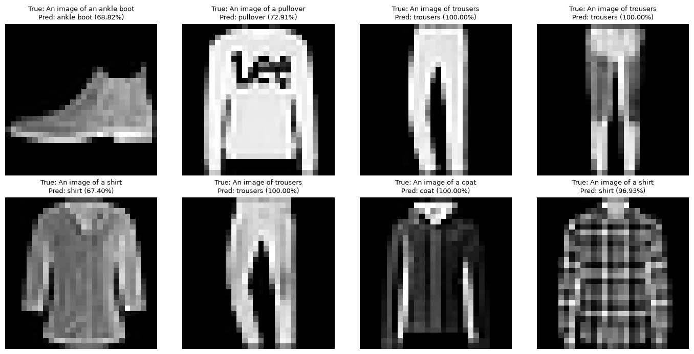
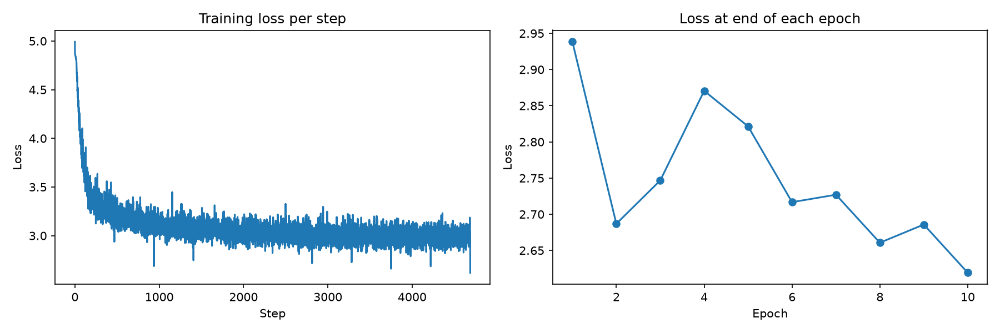

# CLIP from Scratch

A minimal, readable implementation of [CLIP](https://arxiv.org/abs/2103.00020) (Contrastive Language–Image Pre-training) in pure PyTorch. Every component is written by hand: attention, transformer blocks, a Vision Transformer, a byte-level text encoder, and the symmetric contrastive loss. No `transformers` or `open_clip` is used.

The model is trained on Fashion-MNIST with class captions such as *"An image of a sneaker"*, then used for **zero-shot style classification**: an image is matched against free text instead of a fixed label set. It is small enough to train in minutes on a single consumer GPU.



## Features

- Multi-head self-attention and transformer encoder blocks written from scratch
- Vision Transformer image encoder (patch embedding, `[CLS]` token, sinusoidal positional encoding)
- Text encoder with a UTF-8 tokenizer (vocab size 256, no external tokenizer), SOT/EOT tokens and attention masking
- Symmetric InfoNCE loss with a learnable temperature
- Single notebook with a short explanation before each component

## Architecture

```
            image ──► ViT (patches + [CLS]) ──► projection ──► L2 norm ──┐
                                                                         ├─► cosine similarity ─► symmetric cross-entropy
 "An image of a sneaker" ──► UTF-8 tokenizer ──► Transformer ──► EOT token ──► projection ──► L2 norm ──┘
```

For a batch of N image–caption pairs, the model builds an N×N similarity matrix. The N correct pairs on the diagonal are pushed up and all other pairs are pushed down, in both the image→text and text→image directions.

| Setting | Value |
| --- | --- |
| Embedding dim | 32 |
| Image size / patch size | 28×28 / 14×14 (4 patches) |
| ViT width / layers / heads | 9 / 3 / 3 |
| Text width / layers / heads | 32 / 4 / 8 |
| Max text length | 32 bytes |
| Optimizer | Adam, lr 1e-3 |
| Epochs / batch size | 10 / 128 |

## Results

Training loss over 10 epochs:



The notebook ends with a zero-shot demo that ranks the ten class names for each test image (see the image at the top).

<!-- TODO: add the measured zero-shot accuracy on the 10k test set, e.g. "Zero-shot accuracy: XX.X%" -->

## Getting Started

```bash
git clone https://github.com/<your-username>/clip-from-scratch.git
cd clip-from-scratch
conda env create -f environment.yml
conda activate clip
jupyter notebook clip.ipynb
```

To skip training and use the included checkpoint `best.pt`, run the cells that define the classes and hyperparameters, then the final cell, which loads the weights and shows predictions.

## Project Structure

```
.
├── clip.ipynb        # model, training loop and zero-shot demo
├── best.pt           # trained weights (~365 KB)
├── environment.yml   # conda environment
├── loss_curve.png    # training loss figure
├── prediction.png    # zero-shot demo figure
└── README.md
```

## Limitations

- The text side only ever sees ten fixed captions, so the model learns to separate those ten sentences rather than general language. It will not generalize to unseen wording.

## References

- Radford et al., [Learning Transferable Visual Models From Natural Language Supervision](https://arxiv.org/abs/2103.00020), 2021
- Dosovitskiy et al., [An Image is Worth 16x16 Words](https://arxiv.org/abs/2010.11929), 2020
- Vaswani et al., [Attention Is All You Need](https://arxiv.org/abs/1706.03762), 2017
